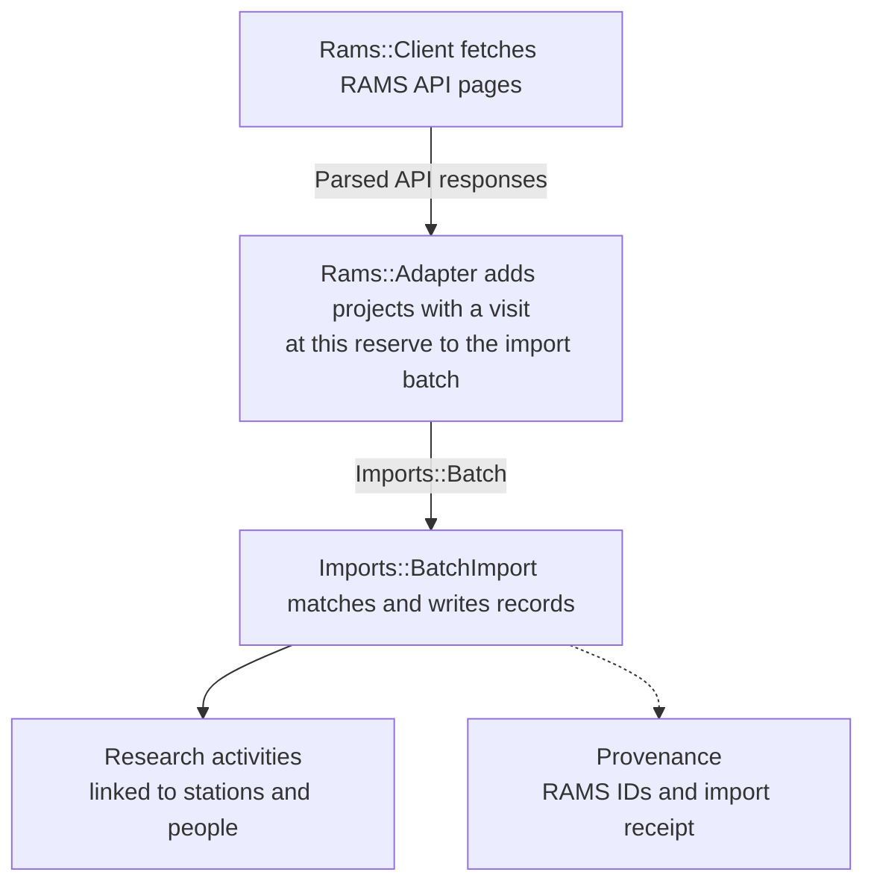

# Source imports

FAIR Station imports research activity one reserve at a time. A visit at the
selected reserve brings the RAMS project into scope. The project's team
memberships supply its people and their roles.

The adapter is configured for one reserve. It uses that reserve ID to filter
visits in the API responses, then returns an in-memory `Imports::Batch`.
Within the caller's transaction, the importer writes stations, people,
activities, and memberships in that order.

**On a rerun**, the importer uses record type and RAMS ID within the same source
installation to find the local record. If a project visits two reserves, importing
the second reserve adds a station link to the same activity. Existing station
metadata stays intact. A conflicting ORCID stops the import for the caller to
roll back.

**On success**, the caller commits the research records and their provenance
together. Source identifiers link local records to their RAMS IDs and import
receipt. The receipt records the source, reserve, sync timestamps, and paths
and checksums for local evidence. A failed import leaves the last successful
sync time intact.
