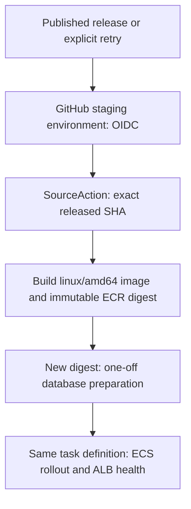

# FAIR Station staging on AWS

Run `python3 infra/provision.py "$STAGING_CONFIG"` only after the staging administrator supplies and reviews the configuration below. This command creates billable resources. No production environment or RAMS resource is managed by these templates.

## Architecture and ownership

Three ordinary CloudFormation stacks keep the database lifecycle independent from the application and pipeline. `provision.py` deploys them in dependency order; Sceptre is not required.

| Stack | Owns | Dependency |
|---|---|---|
| `fairstation-stg-database` | Dedicated encrypted RDS MySQL 8.4, generated Secrets Manager credentials, database/task security groups, SSM database coordinates | Existing VPC and private database subnets |
| `fairstation-stg-runtime` | Immutable ECR repository, private Fargate tasks, public HTTPS ALB, log group, optional ACM certificate and Route 53 alias | Database outputs, public/task subnets, hostname/certificate or DNS zone |
| `fairstation-stg-pipeline` | CodePipeline V2, separate Build/Migrate/Deploy CodeBuild projects, private artifact bucket, scoped service roles and GitHub OIDC role | Runtime outputs, existing CodeConnections connection and OIDC provider |

This follows the UC3 [upstream architecture](https://github.com/CDLUC3/ngrams-infrastructure/blob/main/README.md), [operating conventions](https://github.com/CDLUC3/ngrams-infrastructure/blob/main/PRACTICAL_INFO.md), and [SSM runtime contract](https://github.com/CDLUC3/ngrams-infrastructure/blob/main/SSM_RUNTIME_PARAMETER_CONTRACT.md). It does **not** import RAMS database endpoints, passwords, certificates, application roles, or buckets. FAIR Station uses `/uc3/fairstation/stg`, not `/uc3/rams/stg`.



`QUEUED` execution serializes the entire pipeline. Automatic source change detection and restart-on-stack-update are disabled. Releases, not branch pushes, initiate deployment. The source action must remain named `SourceAction` because GitHub overrides that action's revision.

Every start must also supply the required `ReleaseSha` pipeline variable. Each stage
checks it against the actual source revision before making changes. A creation-time
execution or manual start without an explicit matching release SHA cannot build or
deploy an unqualified branch tip.

## Required staging configuration

Store a local JSON object outside the checkout. These are real environment values, not defaults to copy from RAMS:

| JSON key | Type / requirement |
|---|---|
| `AccountId` | String: approved staging AWS account; compared with STS before changes |
| `Region` | String: approved AWS region; UC3 staging convention is `us-west-2` |
| `VpcId` | Existing VPC ID |
| `PublicSubnetIds` | JSON array of at least two public subnet IDs in distinct AZs for the ALB |
| `TaskSubnetIds` | JSON array of at least two private subnet IDs with outbound connectivity |
| `DatabaseSubnetIds` | JSON array of at least two private subnet IDs in distinct AZs for RDS |
| `Hostname` | Approved FAIR Station staging FQDN, without scheme or path |
| `ConnectionArn` | Existing **AVAILABLE**, same-account, same-region GitHub CodeConnections ARN authorized for `CDLUC3/FAIRStation` |
| `GitHubOidcProviderArn` | Existing account `token.actions.githubusercontent.com` IAM provider ARN; no duplicate provider is created |
| `HostedZoneId` | Optional existing **public** Route 53 zone: creates the hostname alias; also enables automatic DNS validation when no certificate ARN is supplied |
| `CertificateArn` | Optional existing same-region ACM certificate covering `Hostname`; either this or `HostedZoneId` is required |
| `CloudFormationServiceRoleArn` | Optional approved CF execution role; the caller needs permission to pass it |
| `SecretKeyKmsKeyArn` | Optional customer-managed key for the Rails SSM secret; omitted uses `alias/aws/ssm` |
| `DatabaseInstanceClass` | Optional, defaults to `db.t4g.micro` |
| `DatabaseEngineVersion` | Optional exact regional MySQL 8.4 version, defaults to `8.4.11`; confirm regional availability before launch |
| `MultiAZ` | Optional JSON boolean, defaults to `false`; enable for database AZ redundancy |

Private tasks have **no public IPs**. Supply NAT connectivity or the complete endpoints required for ECR API/DKR, S3 image layers, CloudWatch Logs, SSM and Secrets Manager. Application outbound calls additionally require their own network route. Database subnets must not expose RDS publicly. Existing UC3 subnet names alone are not proof that a subnet is private or has NAT.

When `HostedZoneId` is supplied, it must be authoritative for `Hostname`; the stack manages the new A alias and, if needed, an ACM DNS-validated certificate. Do not point it at an existing record owned elsewhere. With an existing certificate and no zone ID, create the DNS alias yourself using the runtime stack's `LoadBalancerDnsName` and `LoadBalancerHostedZoneId` outputs before declaring the site operational.

The administrator must approve IAM, EC2 security groups, RDS, Secrets Manager, SSM, ECR, ECS, ELBv2, Logs, S3, CodeBuild and CodePipeline creation; ACM/Route 53 permissions are also needed when those resources are enabled. The CF role needs access to resolve the dedicated database secret. The provisioning caller reads CodeConnections status, creates the SSM secret, checks existing ECS state, enables database-stack termination protection, and optionally passes the CF service role. An existing compatible ECS service-linked role or permission to create it is required.

## Provision and first release

1. Authenticate and inspect the account; set `STAGING_CONFIG` to the reviewed local JSON file.

   ```sh
   aws sso login --profile "$AWS_PROFILE"
   aws sts get-caller-identity
   python3 infra/provision.py "$STAGING_CONFIG"
   ```

   Python 3 and current AWS CLI v2 (including `codeconnections`) are required locally. No third-party Python package is needed. Before creating resources, the script rejects account/connection-region mismatches and connections that are not AVAILABLE GitHub connections. It creates a random 128-hex-character SSM signing secret only when absent and never prints its value. Its final JSON reports the exact GitHub environment variables.

2. Configure GitHub's **staging** environment with `AWS_REGION`, `AWS_RELEASE_ROLE_ARN`, and `AWS_PIPELINE_NAME` from that output. Protect release deployment with environment reviewers/policies. The OIDC role trusts exactly `repo:CDLUC3/FAIRStation:environment:staging` and audience `sts.amazonaws.com`; it permits only `codepipeline:StartPipelineExecution` on this pipeline. Do not create static AWS access-key secrets.

3. Publish the manually reviewed release-please release after promotion to `main`. The release must contain the production Dockerfile and `infra/` pipeline files. GitHub's release workflow resolves the release tag to a full commit SHA and starts the pipeline. An authorized administrator can start the identical operation explicitly:

   ```sh
   aws codepipeline start-pipeline-execution \
     --name fairstation-stg \
     --source-revisions "actionName=SourceAction,revisionType=COMMIT_ID,revisionValue=$RELEASE_SHA" \
     --variables "name=ReleaseSha,value=$RELEASE_SHA"
   ```

4. Check the pipeline and the application:

   ```sh
   aws codepipeline list-pipeline-executions --pipeline-name fairstation-stg
   aws logs tail /aws/codebuild/fairstation-stg --follow
   curl --fail "https://$HOSTNAME/up"
   ```

The first runtime stack creates a service at **desired count zero** with an unpulled bootstrap image reference. No fake image needs pushing and no web process runs before migration. Build creates the real image; Migrate uses a newly registered definition with that digest even on an empty database; Deploy starts the service at one task. The first service launch therefore uses the already-migrated image, never the bootstrap reference.

Run `provision.py` again for infrastructure changes **only while releases are paused**. It preserves the active service's image and desired count, and updates the migration project's baseline task definition from the new runtime stack. This prevents a template update reverting the application to the bootstrap image. Do not directly redeploy `runtime.yaml` with default parameters after initial launch. The release pipeline owns subsequent ECS task-definition revisions; this intentional runtime drift is reconciled by the provisioning script.

## Runtime secrets, networking and backups

| Application variable | Source |
|---|---|
| `DATABASE_HOST`, `DATABASE_PORT`, `DATABASE_NAME` | SSM Strings `/uc3/fairstation/stg/RdsHost`, `RdsPort`, `RdsName`, created by the database stack |
| `DATABASE_USERNAME`, `DATABASE_PASSWORD` | JSON fields in dedicated Secrets Manager secret `/uc3/fairstation/stg/database` |
| `SECRET_KEY_BASE` | SSM SecureString `/uc3/fairstation/stg/secret_key_base`, generated once by provisioning |
| `RAILS_ALLOWED_HOSTS` | Approved `Hostname`, supplied inline to the task |
| `RAILS_ENV`, `PORT` | `production`, `3000` |

The task execution role can read only these named SSM parameters and the dedicated database secret, pull only this ECR repository, and write this application log group. The application task role has no AWS permissions. The pipeline build role cannot update ECS; the deployment role can run only the FAIR Station task family in its cluster and pass only its two task roles. AWS APIs that do not support resource-level scoping (`RegisterTaskDefinition`, `DescribeTaskDefinition`, ECR authorization and target-health descriptions) use `Resource: '*'` solely for those actions.

ALB terminates TLS 1.2/1.3, redirects HTTP to HTTPS and forwards only the configured hostname. Tasks accept port 3000 only from its security group; MySQL accepts port 3306 only from the FAIR Station task security group. `/up` is the target health check and bypasses Rails host/SSL checks needed for ALB's internal health request. It is a liveness check, not a database-readiness assertion.

RDS is encrypted, non-public, deletion-protected and backed up for **14 days**. Deletion/replacement snapshots are enabled and the database stack gets termination protection. ECR, database credentials, artifact bucket and application/build logs are retained on stack deletion. Application/build logs retain **30 days** of events; artifact current versions expire after **90 days**, noncurrent versions after **30 days**. ECR has no automatic image expiry so rollback digests remain available. RDS exports error and slow-query logs; configure separate retention for the RDS-managed log groups under the organization's logging policy.

There is no automatic password-rotation schedule: the dedicated secret is generated by Secrets Manager, while RDS resolves its username/password at creation. Rotation must update RDS and ECS together; changing only the stored secret would break future tasks. Neither the app nor its service roles can rotate credentials.

### Supported database password rotation

This is an **operator-approved outage**, not a release step. Pause GitHub release starts and all manual pipeline starters; wait for existing executions to finish. Use an authenticated staging administrator with Secrets Manager read/version-write, RDS modify/describe, ECS update/describe, pipeline list and CF describe permissions:

```sh
python3 infra/rotate_database_secret.py --maintenance-window
```

The command saves a newly generated password as `AWSPENDING`, prints a non-secret recovery command, scales web tasks to zero, applies the same password to RDS, waits for RDS availability, moves `AWSCURRENT`, and restores the original desired count. It never places credentials in arguments or logs. If interrupted, **keep releases paused** and run the printed command with its original `--version-id` and `--desired-count`; the same pending password is reapplied safely. Do not generate another password or resume traffic while RDS and `AWSCURRENT` differ. After success, verify the application and resume release starts. Existing DB snapshots do not replace secret backups: preserve access to the retained secret and relevant versions during restore.

Rotate the Rails signing key only during a coordinated service restart; it invalidates signed sessions. Update its SecureString through an approved secret-management tool, then force a service deployment. Do not put signing keys or database passwords in GitHub, the config JSON, or CloudFormation parameters.

## Release evidence and failure handling

The full source SHA is an immutable ECR `sha-<SHA>` tag, an OCI revision label, the task's `RELEASE_SHA`, and the build/deployment JSON artifacts. A retry reuses an existing immutable SHA image rather than overwriting it. Both downstream stages reject artifacts with a different source SHA or repository/digest format. Migrate publishes `deployment.json` only after its new-image task exits zero; launch failures, missing exit codes and timeouts fail the stage. Deploy checks the exact migrated task definition, ECS rollout state, running count and healthy ALB targets; an ECS circuit-breaker rollback is a failure, not a successful stable deployment.

If migration fails, Deploy does not run and the old web service stays unchanged. Inspect `/ecs/fairstation-stg` using the migration task ARN printed in build logs. A failed first deployment leaves the service empty or failed rather than starting an unmigrated image. Migration execution is limited to 30 minutes and stopped on timeout. Do not cancel the CodeBuild migration job while its ECS task is running: a hard external cancellation can bypass cleanup; stop the printed one-off task explicitly before retrying.

For an application rollback, start the pipeline at an earlier released SHA using the same source override. **Review schema compatibility first:** database migrations are not automatically reversed, and `db:prepare` runs the selected release's migrations before deployment. For destructive schema changes, restore the dedicated database from its snapshot/PITR in an approved recovery procedure instead of assuming an image rollback restores data.

## Offline validation (no AWS authentication)

Run these from the repository root after all changes are integrated:

```sh
cfn-lint infra/templates/database.yaml infra/templates/runtime.yaml infra/templates/pipeline.yaml
python3 -m py_compile infra/pipeline.py infra/provision.py infra/rotate_database_secret.py
ruby -ryaml -e 'Dir["infra/buildspec-*.yaml"].each { |path| YAML.load_file(path) }'
```

CloudFormation `validate-template`, AWS deployment, and service health checks are **online**, not offline validation. These files have not provisioned an account merely because they exist or pass syntax checks. Live setup still requires renewed SSO authorization, verified account/network/DNS/connection parameters and administrator permissions. The repository does not infer or fabricate those values from another application's deployment.
